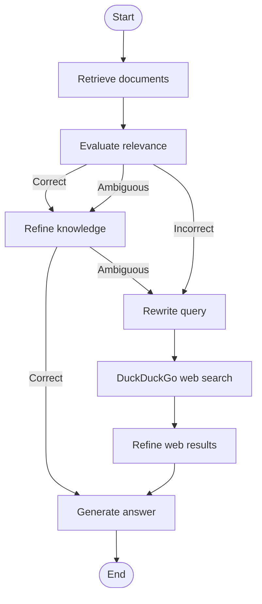

# Corrective Retrieval-Augmented Generation (CRAG)

A local-first implementation of **Corrective Retrieval-Augmented Generation (CRAG)** using LangGraph, LangChain, FAISS, and Ollama. The workflow evaluates retrieved documents, refines relevant information, and can fall back to web search when local retrieval is insufficient.

## Features

- **Vector retrieval:** Uses FAISS to retrieve relevant documents from a local knowledge corpus.
- **Retrieval evaluation:** Scores retrieved documents and classifies retrieval confidence as `correct`, `ambiguous`, or `incorrect`.
- **Knowledge refinement:** Splits retrieved text into smaller strips, scores them, filters less relevant strips, and recomposes the retained information.
- **Query rewriting:** Generates a concise search query when corrective web search is needed.
- **Web-search fallback:** Uses DuckDuckGo search through `ddgs`.
- **Local model support:** Uses Ollama for LLM inference and text embeddings by default.
- **Conditional workflow:** Uses LangGraph to route execution based on retrieval confidence.

## Architecture



The implemented routing is:

| Retrieval confidence | Workflow |
|---|---|
| `correct` | Retrieve → Evaluate → Refine → Generate |
| `ambiguous` | Retrieve → Evaluate → Refine → Rewrite query → Web search → Generate |
| `incorrect` | Retrieve → Evaluate → Rewrite query → Web search → Generate |

## Technology Stack

- Python
- LangGraph
- LangChain
- FAISS
- Ollama
- DuckDuckGo Search (`ddgs`)
- Hugging Face Sentence Transformers (optional, depending on provider configuration)

## Prerequisites

1. Python 3.10 or later (use a version supported by the installed dependencies).
2. [Ollama](https://ollama.com/) installed and running.
3. Git installed.

Pull the default local models:

```bash
ollama pull llama3.2:3b
ollama pull nomic-embed-text
```

The project uses `llama3.2:3b` for generation and `nomic-embed-text` for embeddings when configured as below.

## Installation

Clone the repository:

```bash
git clone https://github.com/Priti-student/CRAG
cd crag_langgraph
```

Create and activate a virtual environment.

**Windows PowerShell:**

```powershell
python -m venv venv
.\venv\Scripts\Activate.ps1
```

**macOS / Linux:**

```bash
python -m venv venv
source venv/bin/activate
```

Install dependencies:

```bash
pip install -r requirements.txt
```

## Configuration

Create a `.env` file in the project root. Example configuration for the local Ollama setup:

```env
CRAG_LLM=ollama
CRAG_MODEL=llama3.2:3b

CRAG_EMBED=ollama
CRAG_EVALUATOR=llm
CRAG_SEARCH=ddg

CRAG_UPPER=0.6
CRAG_LOWER=0.3
CRAG_STRIP=0.5
```

Keep API keys and personal configuration out of version control. If you use a hosted provider, follow the corresponding configuration supported by `providers.py`.

## Run the Project

Make sure Ollama is running and the required models have been downloaded. Then run:

```bash
python crag_graph.py
```

The current script builds the FAISS index from a small demonstration corpus, prints the LangGraph workflow as Mermaid, and runs two sample questions.

## Project Structure

```text
crag_langgraph/
├── crag_graph.py       # LangGraph workflow, nodes, and routing
├── crag_logic.py       # Confidence decisions and text refinement helpers
├── providers.py        # LLM, embedding, evaluator, and search providers
├── test_logic.py       # Unit tests for core CRAG helper functions
├── requirements.txt    # Python dependencies
├── .env                # Local configuration (not committed)
├── .env.example        # Example configuration (optional)
├── .gitignore
└── README.md
```

## Core Workflow

1. **Retrieve:** FAISS retrieves the top-k documents for the user's question.
2. **Evaluate:** The evaluator scores each retrieved document and determines the retrieval confidence.
3. **Refine:** Relevant documents are decomposed into smaller text strips. The strips are scored, filtered, and recomposed into internal knowledge.
4. **Rewrite:** If retrieval is incorrect or remains ambiguous after refinement, the LLM creates a concise web-search query.
5. **Web search:** DuckDuckGo retrieves external pages for the rewritten query. The returned text is refined.
6. **Generate:** The LLM receives the available internal and external knowledge and generates an answer. It is instructed not to guess when the evidence is insufficient.

## Run the Logic Tests

```bash
python test_logic.py
```

## Current Scope and Limitations

- The demonstration corpus is currently defined directly in `crag_graph.py`.
- The FAISS index is created at runtime; persistent indexing and document ingestion (for example, PDF upload) are not yet included in this demo.
- Search depends on an external search service and internet connectivity. Search requests can fail or time out.
- The local model's answer quality depends on its size, capabilities, and available context.
- Confidence thresholds are configurable and should be calibrated for the chosen evaluator and dataset.
- This is an educational/local-first implementation inspired by the CRAG workflow, not an exact reproduction of the original research implementation.

## Future Improvements

- Add PDF and other document ingestion.
- Persist and reload the FAISS index.
- Improve web-search reliability with retries and graceful error handling.
- Add evaluation datasets and retrieval/generation metrics.
- Add a user interface and conversation history.
- Compare local and hosted LLM/evaluator backends.

## Acknowledgements

This project is inspired by the Corrective Retrieval-Augmented Generation (CRAG) approach, which introduces retrieval evaluation and corrective actions to improve the reliability of RAG systems.
